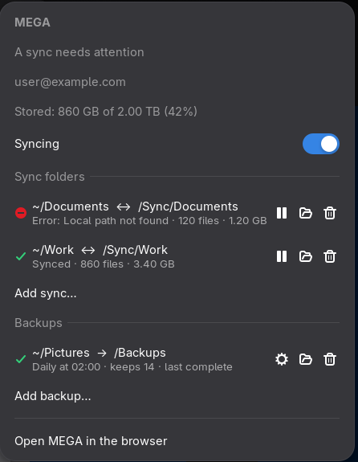

# megacmd-applet

MEGA in the desktop's panel: sync folders, backups, storage and transfers,
driven by [MEGAcmd](https://github.com/meganz/MEGAcmd) instead of the MEGAsync
desktop app. It runs in the [Omarchy](https://omarchy.org) bar, KDE Plasma 6,
GNOME Shell 48–51 and the COSMIC panel.

- A cloud icon in the panel showing the overall state: up to date, syncing,
  paused, storage nearly full, an error, or logged out.
- A popup to pause, resume, add and remove sync folders and scheduled,
  versioned backups, with storage use and transfer progress, and a switch
  that pauses or resumes all syncing.
- A desktop notification once per problem: a sync error, a failed backup,
  being logged out, the MEGAcmd engine stopping, and storage use crossing 90%
  and 95%. Notifications name no folder; clicking one opens the popup, which
  shows it.
- The applet never starts the MEGAcmd engine by itself. When the engine is
  stopped it says so, and "Start MEGAcmd" in the popup starts it again.

| Omarchy | KDE Plasma | GNOME Shell | COSMIC |
|---|---|---|---|
|  |  |  |  |

Every desktop shares one core, a small Python program in `core/` that reads
MEGAcmd's state, decides what it means, keeps track of which notifications
were already shown and runs the actions. Each desktop's part only draws what
the core reports.

## Requirements

- MEGAcmd, from [MEGA's Linux downloads](https://mega.io/cmd#download) (the
  package is `megacmd`).
- `python3`, `gum` (for the guided dialogs) and `pgrep`.
- A terminal for the guided dialogs. The applet uses `xdg-terminal-exec` when
  installed, else the first it finds of Ptyxis, GNOME Console, GNOME
  Terminal, Konsole, COSMIC Terminal, kitty, foot and Alacritty, else
  `$TERMINAL`; a terminal command can also be set in the settings.

## Installation

First run the MEGAcmd engine from login, so syncs and backups run without a
window:

```sh
mkdir -p ~/.config/systemd/user
cp systemd/mega-cmd-server.service ~/.config/systemd/user/
systemctl --user enable --now mega-cmd-server.service
```

Then install the applet for your desktop. The KDE, GNOME and COSMIC files are
attached to each [release](https://github.com/YardQuit/megacmd-applet/releases),
with their `SHA256SUMS`; each can also be built from a checkout with `make`.

### Omarchy

```sh
omarchy plugin add https://github.com/yardquit/megacmd-applet --enable
```

### KDE Plasma 6

```sh
kpackagetool6 --type Plasma/Applet --install megacmd-applet-kde-<version>.plasmoid
```

or `make install-kde` from a checkout. Then add **MEGA** to a panel from
*Add or Manage Widgets*.

### GNOME Shell

```sh
gnome-extensions install megacmd@yardquit.github.io.shell-extension.zip
```

or `make install-gnome` from a checkout. Log out and in, then turn it on with
`gnome-extensions enable megacmd@yardquit.github.io` or in the Extensions app.

### COSMIC

Unpack the release archive under `/usr`:

```sh
sudo tar -xzf megacmd-applet-cosmic-<version>-x86_64.tar.gz -C /usr --strip-components=1
```

or build and install it for yourself with `make install-cosmic`, which puts
it under `~/.local` (set `PREFIX` for elsewhere). Building needs Rust and the
development files for libxkbcommon, Wayland, EGL, D-Bus and systemd. Then add
**MEGA** in *Settings → Desktop → Panel → Applets*.

### Logging in

Click the cloud icon and choose **Log in to MEGA**. A terminal opens
MEGAcmd's own shell, which asks for the password and 2FA code itself, so the
password never appears in a command line. The session is kept, so this is
needed only once. `mega-login` in a terminal does the same.

If MEGAsync is installed, quit it before adding the same folders here: two
programs syncing one folder produce conflicting copies.

## Removal

| Desktop | Command |
|---|---|
| Omarchy | `omarchy plugin remove yardquit.mega` |
| KDE Plasma | `kpackagetool6 --type Plasma/Applet --remove io.github.yardquit.megacmd` |
| GNOME Shell | `gnome-extensions uninstall megacmd@yardquit.github.io` |
| COSMIC | remove it from the panel, then delete `bin/cosmic-applet-megacmd`, `share/megacmd-applet/`, `share/applications/io.github.yardquit.MegaCmd.desktop` and `share/icons/hicolor/scalable/apps/io.github.yardquit.MegaCmd-*` from where it was installed |

To stop the engine as well:

```sh
systemctl --user disable --now mega-cmd-server.service
rm ~/.config/systemd/user/mega-cmd-server.service
```

Removing the applet leaves MEGAcmd's syncs and backups as they are; stopping
the engine pauses them until it runs again. Remove them in the popup first to
stop them for good.

## Use

Click the cloud icon to open the popup. Each sync folder has buttons to pause
or resume it, open its folder and remove it; each backup has buttons to
change its schedule and the number kept, open its folder and remove it.
Removing asks for a second press, and the files stay where they are.

**Add sync…** and **Add backup…** open a short guided dialog in a terminal:
pick the local folder, confirm or change the suggested MEGA folder and, for a
backup, choose the schedule and how many backups to keep. Each backup is a
dated copy named `<folder>_bk_<time>` inside the chosen MEGA folder. Changing
a backup offers the current values first; backups already made stay as they
are.

In the Omarchy bar, a right click pauses or resumes all syncing and a middle
click refreshes. In its panel, the arrow keys move between rows and Enter
runs a row's main action; `o` opens the selected folder, `s` changes the
selected backup, `x` pressed twice removes the selected sync or backup, `p`
pauses or resumes all syncing, `r` refreshes, and Escape closes the panel.

## Settings

| Setting | Default | Meaning |
|---|---|---|
| Refresh interval | 60 | How often to check MEGAcmd while the popup is closed, in seconds (every 3 seconds while it is open) |
| MEGA folder for new syncs | `/` | Suggested parent folder in MEGA when adding a sync |
| MEGA folder for backups | `/Backups` | Suggested folder in MEGA for new backups |
| Terminal command | empty | Command that runs a program in a terminal, such as `kitty` or `konsole -e`; empty finds one |
| Preview | empty | A saved state from `fixtures/` to show instead of the live one |

Where to set them:

- **Omarchy**: on the widget's entry in `~/.config/omarchy/shell.json`, as
  `refreshIntervalSec`, `syncFolder` and `backupFolder`:
  `{ "id": "yardquit.mega", "syncFolder": "/Sync" }`. The terminal is
  Omarchy's own.
- **KDE Plasma**: the widget's *Configure MEGA…* dialog.
- **GNOME Shell**: the extension's preferences (`gnome-extensions prefs
  megacmd@yardquit.github.io`).
- **COSMIC**: one file per setting in
  `~/.config/cosmic/io.github.yardquit.MegaCmd/v1/`, named
  `refresh_interval_sec`, `sync_folder`, `backup_folder`, `terminal` and
  `preview_name`, holding a number or a quoted string, such as `"/Sync"`. The
  applet picks up changes at once.

The saved states are `ok`, `syncing`, `paused`, `sync-error`,
`backup-failed`, `storage-90`, `storage-95`, `logged-out` and `stopped`.
Previews also send their notifications, marked "(preview)". While a preview
is shown, the popup's actions do nothing, as its syncs and backups are only
examples.

The Omarchy widget also answers `omarchy-shell yardquit.mega <command>`:
`open`, `close` and `toggle` show or hide the panel, `refresh` checks MEGAcmd
now, `status` prints the overall state, `preview <state>` shows a saved state
and `live` returns to the live one.

## Command line

The core runs on its own as `bin/megacmd-applet`:

| Command | Does |
|---|---|
| `status` | Print MEGAcmd's state, its meaning and texts as JSON, with any new notifications |
| `pause ID`, `resume ID`, `remove-sync ID` | Pause, resume or remove a sync |
| `remove-backup TAG` | Remove a backup; its files stay |
| `pause-all`, `resume-all`, `toggle-all` | Pause or resume every sync |
| `guided NAME [ARGS]` | Open a guided dialog in a terminal |

`status --fixture FILE --home /home/user` reads a saved state instead of
asking MEGAcmd. `megacmd-applet --help` lists every option.

## Privacy

Other accounts on the same computer can see the command lines of running
programs. The applet's regular status check passes no folder names, and its
notifications name none. Folder paths do appear in command lines when you act
yourself: opening a folder starts the file manager with its path, and adding
or changing a sync or backup runs MEGAcmd's commands, which take the paths as
arguments, in a terminal that also shows the suggested MEGA folder.

## Development

| Folder | Holds |
|---|---|
| `core/megacmd_applet/` | The shared core: reading MEGAcmd (`megacmd.py`), state rules and texts (`model.py`), the view each desktop draws (`view.py`), notifications (`notices.py`), actions (`actions.py`) and the command line (`cli.py`) |
| `bin/` | The core's command, and the guided terminal dialogs: log in, add a sync, add or change a backup |
| `fixtures/` | Saved states for previews and tests |
| `omarchy/` | The Omarchy plugin (`manifest.json` at the top level points into it) |
| `kde/` | The Plasma widget |
| `gnome/` | The GNOME Shell extension |
| `cosmic/` | The COSMIC applet, in Rust with libcosmic |
| `tests/` | The test suite |

```sh
make test        # run the tests
make kde gnome   # build the Plasma widget and GNOME extension in build/
make cosmic      # build the COSMIC applet
make dist        # build the release files in build/dist/
```

To work on the Omarchy widget, link a checkout into Omarchy's plugin folder
and run `omarchy restart shell` after changing QML files:

```sh
ln -s "$PWD" ~/.config/omarchy/plugins/yardquit.mega
omarchy plugin enable yardquit.mega
```

The version is set in `manifest.json`; the KDE, GNOME and COSMIC metadata
repeat it, and a test checks that they match. A release is made by pushing a
tag `v<version>`, which builds the release files and attaches them.

## Credits

The Omarchy panel follows the structure of Omarchy's own Dropbox and
Tailscale widgets and uses Omarchy's shell components. The COSMIC applet
follows the layout of the applets in COSMIC's own `cosmic-applets`. MEGA and
MEGAcmd are made by MEGA Limited.

## Licence

GPL-3.0-or-later. See [LICENSE](LICENSE).
