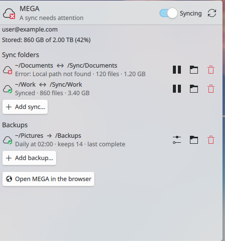
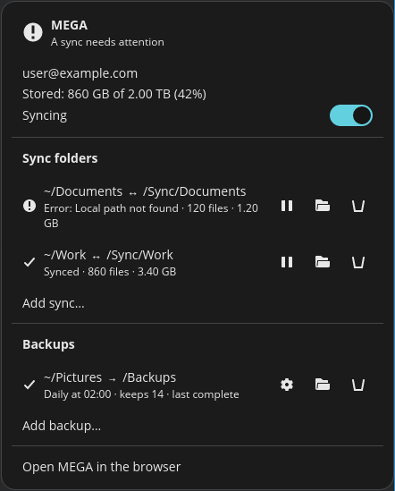

# megacmd-applet

MEGA in the desktop's panel: sync folders, backups, storage and transfers,
driven by [MEGAcmd](https://github.com/meganz/MEGAcmd) instead of the MEGAsync
desktop app. It runs in the [Omarchy](https://omarchy.org) bar, KDE Plasma 6,
GNOME Shell 48–51 and the COSMIC panel.

- A cloud icon in the panel showing the overall state: up to date, syncing,
  paused, files not syncing, storage nearly full, an error, or logged out.
- A popup to pause, resume, add and remove sync folders and scheduled,
  versioned backups, with storage use and transfer progress, and a switch
  that pauses or resumes all syncing.
- The files MEGA cannot sync, listed in the popup. When a file was changed
  both here and in MEGA, one button keeps this computer's copy, MEGA's copy
  or both; the copy not kept goes to the Trash or the MEGA Rubbish bin.
- A desktop notification once per problem: a sync error, a file that is not
  syncing, a failed backup, being logged out, the MEGAcmd engine stopping, and storage use crossing 90%
  and 95%. Notifications name no folder; clicking one opens the popup, which
  shows it.
- The applet never starts the MEGAcmd engine by itself. When the engine is
  stopped it says so, and "Start MEGAcmd" in the popup starts it again.

| Omarchy | KDE Plasma | GNOME Shell | COSMIC |
|---|---|---|---|
|  |  |  |  |

Every desktop shares one core, a small Python program in `core/` that reads
MEGAcmd's state, decides what it means, keeps track of which notifications
were already shown and runs the actions. Each desktop's part only draws what
the core reports.

## Requirements

- MEGAcmd, from [MEGA's Linux downloads](https://mega.io/cmd#download) (the
  package is `megacmd`).
- `python3`, `gum` (for the guided dialogs), `pgrep`, `xdg-open` and `gio`
  (to move a copy that is not kept to the Trash).
- A terminal for the guided dialogs. The applet uses `xdg-terminal-exec` when
  installed, else the first it finds of Ptyxis, GNOME Console, GNOME
  Terminal, Konsole, COSMIC Terminal, kitty, foot and Alacritty, else
  `$TERMINAL`; a terminal command can also be set in the settings.

## Installation

Install the applet for your desktop, then turn on the MEGAcmd engine's login
unit (below). Each [release](https://github.com/YardQuit/megacmd-applet/releases)
has packages for Fedora, Ubuntu and Arch Linux, standalone files for any
distribution, and `SHA256SUMS` for all of them; check a download before
installing it:

```sh
sha256sum --check --ignore-missing SHA256SUMS
```

Everything can also be built from a checkout with `make`.

### Packages for Fedora, Ubuntu and Arch Linux

`megacmd-applet` holds the shared core, the guided dialogs and the engine's
login unit; add the package for your desktop next to it:

| Package | For |
|---|---|
| `megacmd-applet-kde` | KDE Plasma 6 |
| `megacmd-applet-gnome` | GNOME Shell 48 or later |
| `megacmd-applet-cosmic` | COSMIC (recommends the COSMIC panel) |
| `megacmd-applet-omarchy` | Omarchy (Arch Linux only) |

```sh
sudo dnf install ./megacmd-applet-<version>-1.fc45.x86_64.rpm ./megacmd-applet-kde-<version>-1.fc45.noarch.rpm   # Fedora 45
sudo apt install ./megacmd-applet_<version>-1_all.deb ./megacmd-applet-gnome_<version>-1_all.deb                 # Ubuntu 26.04
sudo pacman -U megacmd-applet-<version>-1-any.pkg.tar.zst megacmd-applet-cosmic-<version>-1-x86_64.pkg.tar.zst  # Arch Linux
```

MEGAcmd itself comes from MEGA's own repository, which the packages
recommend but cannot pull in. Omarchy loads plugins only from each user's own
folder, so after installing `megacmd-applet-omarchy` link it there:

```sh
mkdir -p ~/.config/omarchy/plugins
ln -s /usr/share/megacmd-applet ~/.config/omarchy/plugins/yardquit.mega
omarchy plugin enable yardquit.mega
```

Then add the applet to your panel as described below for your desktop.

### Omarchy

```sh
omarchy plugin add https://github.com/yardquit/megacmd-applet --enable
```

### KDE Plasma 6

```sh
kpackagetool6 --type Plasma/Applet --install megacmd-applet-kde-<version>.plasmoid
```

or `make install-core install-kde` from a checkout. Then add **MEGA** to a
panel from *Add or Manage Widgets*.

### GNOME Shell

```sh
gnome-extensions install megacmd@yardquit.github.io.shell-extension.zip
```

or `make install-core install-gnome` from a checkout. Log out and in, then
turn it on with `gnome-extensions enable megacmd@yardquit.github.io` or in
the Extensions app. The extension is distributed here, not on
extensions.gnome.org, as it runs the shared Python core.

### COSMIC

Unpack the release archive under `/usr`:

```sh
sudo tar -xzf megacmd-applet-cosmic-<version>-x86_64.tar.gz -C /usr --strip-components=1
```

or build and install it for yourself with `make install-core install-cosmic`,
which puts it under `~/.local` (set `PREFIX` for elsewhere); the installed
desktop file names the applet by its full path, so `~/.local/bin` need not be
on the session's `PATH`. Then add **MEGA** in *Settings → Desktop → Panel →
Applets*.

### Building from a checkout

`make install` installs the core and every desktop's part under `~/.local`;
`make install-core` with one part (`install-omarchy`, `install-kde`,
`install-gnome`, `install-cosmic`) installs only that. All need `python3`;
`install-gnome` needs `glib-compile-schemas`; `install-cosmic` needs Rust
(cargo) and the development files for libxkbcommon, Wayland, EGL, D-Bus and
systemd. After `make install-omarchy`, link the plugin into Omarchy:

```sh
mkdir -p ~/.config/omarchy/plugins
ln -s ~/.local/share/megacmd-applet ~/.config/omarchy/plugins/yardquit.mega
```

### Running the engine from login

The packages, the COSMIC archive and `make install-core` install the unit
that runs MEGAcmd's engine from login, so syncs and backups run without a
window. Turn it on for your account:

```sh
systemctl --user enable --now mega-cmd-server.service
```

With the KDE or GNOME files alone (no package), copy it from a checkout first:

```sh
mkdir -p ~/.config/systemd/user
cp systemd/mega-cmd-server.service ~/.config/systemd/user/
```

The unit runs `mega-cmd-server` from `/usr/bin` or `/usr/local/bin`; for one
installed elsewhere, change it with `systemctl --user edit
mega-cmd-server.service`.

### Logging in

Click the cloud icon and choose **Log in to MEGA**. A terminal opens
MEGAcmd's own shell, which asks for the password and 2FA code itself, so the
password never appears in a command line. The session is kept, so this is
needed only once. `mega-login` in a terminal does the same.

If MEGAsync is installed, quit it before adding the same folders here: two
programs syncing one folder produce conflicting copies.

## Removal

| Desktop | Command |
|---|---|
| Omarchy | `omarchy plugin remove yardquit.mega` |
| KDE Plasma | `kpackagetool6 --type Plasma/Applet --remove io.github.yardquit.megacmd` |
| GNOME Shell | `gnome-extensions uninstall megacmd@yardquit.github.io` |
| COSMIC | remove it from the panel, then delete `bin/cosmic-applet-megacmd`, `share/megacmd-applet/`, `share/applications/io.github.yardquit.MegaCmd.desktop`, `share/icons/hicolor/scalable/apps/io.github.yardquit.MegaCmd-*`, `share/licenses/megacmd-applet-cosmic/` and the unit (`lib/systemd/user/mega-cmd-server.service` under `/usr`, `share/systemd/user/` under `~/.local`) from where it was installed |
| Packages | remove them with `dnf`, `apt` or `pacman`, e.g. `sudo dnf remove 'megacmd-applet*'`; for Omarchy run `omarchy plugin remove yardquit.mega` first |

To stop the engine as well:

```sh
systemctl --user disable --now mega-cmd-server.service
```

and, if you copied the unit, `rm ~/.config/systemd/user/mega-cmd-server.service`.

Removing the applet leaves MEGAcmd's syncs and backups as they are; stopping
the engine pauses them until it runs again. Remove them in the popup first to
stop them for good.

## Use

Click the cloud icon to open the popup. Each sync folder has buttons to pause
or resume it, open its folder and remove it; each backup has buttons to
change its schedule and the number kept, open its folder and remove it.
Removing asks for a second press within four seconds, and the files stay
where they are. Only the buttons act: clicking elsewhere on a row does
nothing. When MEGAcmd is stopped, logged out, not installed or cannot be
read, the popup says so, and offers **Start MEGAcmd** or **Log in to MEGA**
where that helps.

Files MEGA cannot sync are listed under **Not syncing**, at most five at a
time. Most often a file was changed both on this computer and in MEGA since
they were last in step, and MEGA waits for a choice. The popup shows the date
and size of each copy and offers three buttons:

- **Keep both** renames MEGA's copy to `name (1).ext`, so both end up in the
  folder on both sides.
- **Keep this computer's** moves MEGA's copy to the MEGA Rubbish bin; this
  computer's copy is then uploaded.
- **Keep MEGA's** moves this computer's copy to the Trash; MEGA's copy is
  then downloaded.

Nothing is deleted, so each choice can be undone from the Trash or the
Rubbish bin. If either copy changed after the popup showed it, the button
does nothing and says so. Other problems, such as a file that cannot be
read, offer **Open folder**; `mega-sync-issues --detail --all` in a terminal
shows every issue in full.

**Add sync…** and **Add backup…** open a short guided dialog in a terminal:
pick the local folder, confirm or change the suggested MEGA folder and, for a
backup, choose the schedule and how many backups to keep. Each backup is a
dated copy named `<folder>_bk_<time>` inside the chosen MEGA folder. Changing
a backup offers the current values first; backups already made stay as they
are.

In the Omarchy bar, a right click pauses or resumes all syncing and a middle
click refreshes; the tooltip shows the state. In its panel, the arrow keys
move between rows and Enter or Space runs a row's main action; `o` opens the
selected folder, `s` changes the selected backup, Delete or `x` pressed twice
removes the selected sync or backup, `p` pauses or resumes all syncing, `r`
refreshes, and Escape closes the panel. Letter keys held with Ctrl, Alt or
Super do nothing.

## Settings

| Setting | Default | Meaning |
|---|---|---|
| Refresh interval | 60 | How often to check MEGAcmd while the popup is closed, in seconds (every 3 seconds while it is open) |
| MEGA folder for new syncs | `/` | Suggested parent folder in MEGA when adding a sync |
| MEGA folder for backups | `/Backups` | Suggested folder in MEGA for new backups |
| Terminal command | empty | Command that runs a program in a terminal, such as `kitty` or `konsole -e`; empty finds one |
| MEGAcmd folder | empty | Folder holding MEGAcmd's `mega-*` commands, searched before the `PATH`; empty uses the `PATH` alone |
| Preview | empty | A saved state from `fixtures/` to show instead of the live one; not in the KDE and GNOME settings dialogs: set `previewName` in the widget's `[Configuration][General]` group of `~/.config/plasma-org.kde.plasma.desktop-appletsrc`, or the extension's `preview-name` key with `gsettings --schemadir <extension folder>/schemas` |
| Core folder | empty | COSMIC only: folder of the shared core, when it is not under the data folders |

Where to set them:

- **Omarchy**: on the widget's entry in `~/.config/omarchy/shell.json`, as
  `refreshIntervalSec`, `syncFolder`, `backupFolder` and `megacmdDir`:
  `{ "id": "yardquit.mega", "syncFolder": "/Sync" }`. The terminal is
  Omarchy's own.
- **KDE Plasma**: the widget's *Configure MEGA…* dialog.
- **GNOME Shell**: the extension's preferences (`gnome-extensions prefs
  megacmd@yardquit.github.io`).
- **COSMIC**: one file per setting in
  `~/.config/cosmic/io.github.yardquit.MegaCmd/v1/`, named
  `refresh_interval_sec`, `sync_folder`, `backup_folder`, `terminal`,
  `megacmd_dir`, `preview_name` and `core_dir`, holding a number or a quoted
  string, such as `"/Sync"`. The applet picks up changes at once.

The saved states are `ok`, `syncing`, `paused`, `sync-error`,
`backup-failed`, `storage-90`, `storage-95`, `logged-out` and `stopped`.
Previews also send their notifications, marked "(preview)". While a preview
is shown, the popup's actions do nothing, as its syncs and backups are only
examples.

The Omarchy widget also answers `omarchy-shell yardquit.mega <command>`:
`open`, `close` and `toggle` show or hide the panel, `refresh` checks MEGAcmd
now, `status` prints the overall state, `preview <state>` shows a saved state
and `live` returns to the live one.

## Command line

The core runs on its own as `bin/megacmd-applet`:

| Command | Does |
|---|---|
| `status` | Print MEGAcmd's state, its meaning, texts and the action to offer as JSON, with any new notifications; always one JSON object, also when MEGAcmd cannot be read |
| `pause ID`, `resume ID`, `remove-sync ID` | Pause, resume or remove a sync |
| `remove-backup TAG` | Remove a backup; its files stay |
| `pause-all`, `resume-all`, `toggle-all` | Pause or resume every sync |
| `open-folder PATH` | Open a local folder (absolute path of an existing folder) in the file manager |
| `guided [--terminal=CMD] NAME -- [ARGS]` | Open a guided dialog in a terminal; the dialog's arguments always follow `--` |

`status --preview NAME` shows the saved state `fixtures/NAME.json` instead of
asking MEGAcmd. `--megacmd-dir=DIR`, given before the command, searches DIR
for MEGAcmd's commands before the `PATH`. Actions exit with status 1 and the
reason on standard error when they cannot be done. `megacmd-applet --help`
lists every option.

## Privacy

Other accounts on the same computer can see the command lines of running
programs. The applet's regular status check passes no folder names, and its
notifications name none. Folder paths do appear in command lines when you act
yourself: opening a folder starts the file manager with its path, and adding
or changing a sync or backup runs MEGAcmd's commands, which take the paths as
arguments, in a terminal that also shows the suggested MEGA folder.

## Development

| Folder | Holds |
|---|---|
| `core/megacmd_applet/` | The shared core: reading MEGAcmd (`megacmd.py`), state rules and texts (`model.py`), the view each desktop draws (`view.py`), notifications (`notices.py`), actions (`actions.py`) and the command line (`cli.py`) |
| `bin/` | The core's command, and the guided terminal dialogs: log in, add a sync, add or change a backup |
| `fixtures/` | Saved states for previews and tests |
| `omarchy/` | The Omarchy plugin (`manifest.json` at the top level points into it) |
| `kde/` | The Plasma widget |
| `gnome/` | The GNOME Shell extension |
| `cosmic/` | The COSMIC applet, in Rust with libcosmic |
| `tests/` | The test suite (the COSMIC applet's tests are in its sources) |
| `packaging/` | Fedora, Debian (for Ubuntu) and Arch packaging, and `build.sh` that builds and checks them |
| `scripts/` | `third-party-licences.py`, which writes the licence texts of the crates linked into the COSMIC applet, with standard texts from `licence-texts/` for crates that ship none |

```sh
make test        # run the core's and the COSMIC applet's tests (test-core, test-cosmic)
make kde gnome   # build the Plasma widget and GNOME extension in build/
make cosmic      # build the COSMIC applet
make dist        # build the release files in build/dist/
make crates      # pack the crates the COSMIC applet needs, for offline builds
make install     # install everything under ~/.local
```

Make variables: `PREFIX` (default `~/.local`), `DESTDIR`, `USER_UNIT_DIR`
(where the engine's unit goes), `PYTHON_INTERPRETER` (the core's interpreter
line when installed, default `/usr/bin/python3`) and `CRATE_TARGETS`. When a
`crates/` folder (unpacked from `make crates`) is at the top of the source,
every build works without the network.

`packaging/` holds the Fedora spec, the Debian packaging used for Ubuntu and
the Arch PKGBUILD. `packaging/build.sh fedora|ubuntu|arch`, run as root in a
fresh container of that distribution, builds the packages into
`build/packages/` and checks them: that the core runs, that every part is in
place and in one package only, and that all packages' dependencies resolve.
CI runs it for every pull request. When the COSMIC applet's crates change,
run `scripts/third-party-licences.py --summary` and update the COSMIC
package's licence in the spec, the PKGBUILD and `debian/copyright`.

To work on the Omarchy widget, link a checkout into Omarchy's plugin folder
and run `omarchy restart shell` after changing QML files:

```sh
ln -s "$PWD" ~/.config/omarchy/plugins/yardquit.mega
omarchy plugin enable yardquit.mega
```

The version is set in `manifest.json`; the KDE, GNOME and COSMIC metadata and
the packaging repeat it, and a test checks that they match (a new version
also needs a new entry in `packaging/debian/changelog` and the spec's
`%changelog`). A release is made by pushing a
tag `v<version>`, which builds the release files and attaches them.

## Credits

The Omarchy panel follows the structure of Omarchy's own Dropbox and
Tailscale widgets and uses Omarchy's shell components. The COSMIC applet
follows the layout of the applets in COSMIC's own `cosmic-applets` and is
built with System76's libcosmic and the other Rust crates listed, with their
licences, in `THIRD-PARTY-LICENCES`, installed beside it under
`share/licenses/megacmd-applet-cosmic/` (`share/doc/megacmd-applet-cosmic/`
on Debian and Ubuntu). MEGA and MEGAcmd are made by MEGA
Limited.

## Licence

GPL-3.0-or-later. See [LICENSE](LICENSE).
